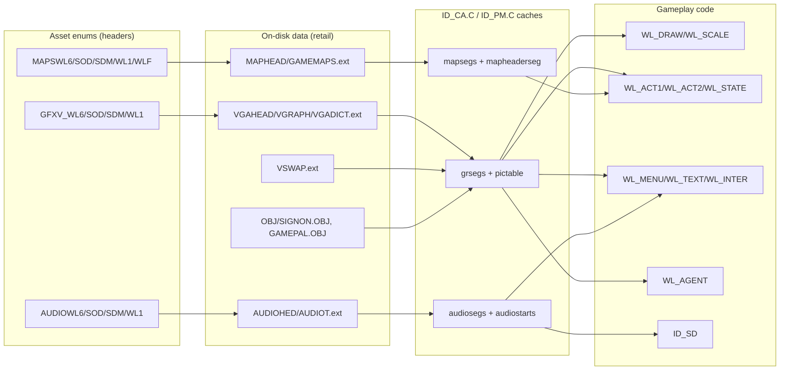

# Code ↔ Asset Relational Map

How the Wolfenstein 3D source (`WOLFSRC/`) binds code to the game data. Every
runtime asset lives behind a fixed-size array in `ID_CA.C` and is fetched by a
numeric chunk id from the enum headers catalogued in `../ASSET-CATALOG.md`.

Product set (`WL6`/`WL1`/`SOD`/`SDM`) is chosen at compile time in `ID_HEADS.H`
and at runtime by the data-file extension set in `WL_MENU.C` (~L3893–3968).

---

## 1. Runtime asset caches

| Array / var | Type | Size macro | Accessor | Backing file(s) | Setup |
| --- | --- | --- | --- | --- | --- |
| `grsegs[NUMCHUNKS]` | `void _seg *` | `NUMCHUNKS` | `CA_CacheGrChunk`, `CA_CacheScreen` | `VGAHEAD`+`VGRAPH`+`VGADICT` (or `EGA*`/`CGA*`) | `CAL_SetupGrFile` ID_CA.C:861 |
| `pictable[NUMPICS]` | `pictabletype` | `NUMPICS` | sprite/pic header table | `VGRAPH` (chunk `STRUCTPIC`) | ID_CA.C:923 |
| `grstarts[]` / `GRFILEPOS(c)` | `long` | `NUMCHUNKS+1` | chunk file offset | `VGAHEAD` | ID_CA.C:893 |
| `grhuffman[255]` | `huffnode` | 255 | `CAL_HuffExpand` | `VGADICT` | ID_CA.C:887 |
| `grneeded[NUMCHUNKS]` | `byte` | `NUMCHUNKS` | `CA_MarkGrChunk`, level bits | (runtime) | `CA_UpLevel`/`CA_DownLevel` |
| `audiosegs[NUMSNDCHUNKS]` | `byte _seg *` | `NUMSNDCHUNKS` | `CA_CacheAudioChunk`, `CA_LoadAllSounds` | `AUDIOHED`+`AUDIOT` | `CAL_SetupAudioFile` ID_CA.C:1026 |
| `audiostarts[]` | `long` | `NUMSNDCHUNKS+1` | chunk offset | `AUDIOHED` | ID_CA.C:1044 |
| `mapsegs[MAPPLANES]` | `word _seg *` | `MAPPLANES`=2 | `CA_CacheMap` | `MAPHEAD`+`GAMEMAPS` | `CAL_SetupMapFile` ID_CA.C:942 |
| `mapheaderseg[NUMMAPS]` | `maptype _seg *` | `NUMMAPS`=60 | map W/H + plane offsets | `MAPHEAD` | ID_CA.C:998 |
| `tinf` | `byte _seg *` | file length | `RLEWtag` + `headeroffsets[100]` + `tileinfo` | `MAPHEAD` | ID_CA.C:961 |
| `grsegs[].SIGNON/GAMEPAL` | linked objects | — | see §4 | `OBJ/SIGNON.OBJ`, `OBJ/GAMEPAL.OBJ` | link-time |

Asset file names are built from globals in `ID_CA.C:88`:
`gheadname=GREXT"HEAD."`, `gfilename=GREXT"GRAPH."`, `gdictname=GREXT"DICT."`,
`mheadname="MAPHEAD."`, `mfilename="MAPTEMP."`, `aheadname="AUDIOHED."`,
`afilename="AUDIOT."`; `CAT: GAMEMAPS.<ext>` (ID_CA.C:974) and
`AUDIO.<ext>` (ID_CA.C:1064) when `CARMACIZED`/`AUDIOHEADERLINKED`.
`VSWAP.<ext>` is opened by the page manager `PageFileName` (ID_PM.C:29).

> Note: `NUMPICS` counts the pic range (`STARTPICS..STARTPICM`); the trailing
> enum block from `STARTEXTERNS` are **externs** (order/error screens + help/
> end/demo art). In this build they are `VGRAPH` chunks loaded via
> `CA_CacheGrChunk` (`ID_CA.C:1318`); only the non-`ARTSEXTERN` build reads
> them as separate files. Hence e.g. WL6 `NUMPICS 132` + `NUMEXTERNS 13` = 145
> enum symbols.

---

## 2. Table-driven bindings (code → asset)

| Table | Defined | Key → value | Resolves to |
| --- | --- | --- | --- |
| `statinfo[]` | WL_ACT1.C:22 | `stat_t`/map code → `picnum`, blocking flag | `SPR_STAT_0..47/50` (VSWAP sprites) |
| `s_*` statetype records | WL_ACT2.C (e.g. :418– :2956) | animation frame → `shapenum`, `think`, `action` | `SPR_*` sprite families |
| `SpawnStand`/`SpawnPatrol` switch | WL_ACT2.C:847 / :983 | `enemy_t` → `s_*stand`/`s_*path` | enemy sprite families |
| `songs[]` | WL_PLAY.C:107 | `mapon+episode*10` → `musicnames` | `AUDIOT[STARTMUSIC+n]` |
| `wolfdigimap[]` | WL_MAIN.C:849 | `soundnames` → digitized index | `AUDIOT[STARTDIGISOUNDS+idx]` |
| `weaponscale[]` | WL_DRAW.C:1198 | `weapontype` → ready sprite | `SPR_*READY` |
| `MainMenu[]` | WL_MENU.C:63 | menu row → label + `CP_*` routine | `C_*` pics via routines |
| `MusicMenu[]` + `DoJukebox` | WL_MAIN.C:975 / :1015 | jukebox row → `songs[]` | `AUDIOT` music |
| `ElevatorBackTo[]` | WL_GAME.C:39 | episode → return map | `GAMEMAPS` |
| `starthitpoints[4][NUMENEMIES]` | WL_ACT2.C:42 | difficulty × enemy → HP | (balance data) |
| `dirangle[9]` | WL_MAIN.C:48 | 8-way dir → view angle | (math) |

### 2.1 Map "thing" codes → spawn ( `ScanInfoPlane`, WL_GAME.C:221 )
| Code(s) | Handler | Asset family |
| --- | --- | --- |
| 19–22 | `SpawnPlayer` | player sprites |
| 23–74 | `SpawnStatic` → `statinfo[]` | `SPR_STAT_*` |
| 90–101 | `SpawnDoor` | door/animation sprites, `DR_*` |
| 98 | pushwall / secret counter | pushwall sprites |
| 108–143 | `SpawnStand`/`SpawnPatrol` (guard/officer/ss/dog) | `SPR_GRD_*`,`SPR_OFC_*`,`SPR_SS_*`,`SPR_DOG_*` |
| 160,178,196,197,214,215 | bosses (WL6) | `SPR_FAKE_*`,`SPR_HITLER_*`,`SPR_SCHABB_*`,`SPR_GRETEL_*`,`SPR_BOSS_*`,`SPR_GIFT_*` |
| 216–259 | `SpawnStand/Patrol(en_mutant)` | `SPR_MUT_*` |
| 224–227 | `SpawnGhosts` (blinky/clyde/pinky/inky) | `SPR_*_W*` ghosts |
| 106,107,125,142,143,161 (Spear) | spectre/angel/trans/uber/will/death | Spear sprite families |

---

## 3. Subsystem ↔ asset matrix

| Subsystem (module) | Reads / writes | Assets consumed |
| --- | --- | --- |
| Cache/memory (`ID_CA`,`ID_PM`,`ID_MM`) | all containers | VSWAP, VGRAPH/EGAGRAPH, GAMEMAPS, AUDIOT |
| Video/palette (`ID_VL`,`ID_VH`,`MUNGE`,`WOLFHACK`) `[ID_VH.C]` | `gamepal`, latch buffer | GAMEPAL, palette lumps, `planepics` |
| Raycast render (`WL_DRAW`,`WL_SCALE`,`WL_DR_A.ASM`,`WL_ASM.ASM`) | VSWAP wall textures | `TILE8` wall set, floor/ceiling |
| Actor/sprites (`WL_ACT2`,`WL_STATE`,`WL_DRAW:DrawScaleds`) | `grsegs[pictable]` | `SPR_*` sprites |
| Status bar (`WL_AGENT`) | `latchpics[]`, `LatchDrawPic` | `STATUSBARPIC`,`FACE*`,`N_*`,`*GUNPIC`,`KEY*` |
| Menus/UI (`WL_MENU`) | `CONTROLS_LUMP`, fonts | `C_*` pics, `STARTFONT+1` |
| Text/help (`WL_TEXT`) | `HELPART`,`T_DEMO*` | `ShowArticle`,`HelpScreens`,`EndText` |
| Intermission (`WL_INTER`) | `LEVELEND_LUMP`, `HIGHSCORES_LUMP`, `COPYPROT_LUMP` | `L_*`, `ENDSCREEN*`, `*PALETTE` |
| Audio (`ID_SD`) | `audiosegs` | PC/AdLib/Digi sounds + music |
| Input (`ID_IN`) | config | `<config>.<ext>` |
| Save (`WL_MAIN` Save/LoadTheGame) | save files | `<SaveName>.<ext>` |
| Demos (`WL_GAME` Play/RecordDemo) | demo stream | `<demoname>.<ext>` |

Key call sites:
- `CA_CacheGrChunk(STARTFONT)` / `MM_SetLock` — ID_CA.C:1318, WL_MAIN.C:1229
- `CA_CacheScreen(TITLEPIC)` — WL_MAIN.C:1511
- `CA_CacheMap(mapon+10*episode)` — WL_GAME.C:650
- `CA_LoadAllSounds()` — WL_GAME.C:759, WL_MENU.C:3051
- `CA_CacheAudioChunk(STARTMUSIC+chunk)` — WL_PLAY.C:1034
- `CacheLump(CONTROLS_LUMP_START,…)` — WL_MENU.C:3041; `LEVELEND_LUMP…` — WL_INTER.C:153
- `LoadLatchMem()` — ID_VH.C:397; `LatchDrawPic` — ID_VH.C:375
- `SD_PlaySound(...)` — e.g. WL_STATE.C:1291, WL_AGENT.C:1138
- `SD_StartMusic(audiosegs[STARTMUSIC+chunk])` — WL_PLAY.C:1041

---

## 4. Linked-in (compile-time) assets

| Asset symbol | Source object | Produced by | Consumers |
| --- | --- | --- | --- |
| `signon` / `introscn` | `OBJ/SIGNON.OBJ` | MakeOBJ v1.2 (SIGNON.BIN) | `SignonScreen` WL_MAIN.C:727 → `VL_MungePic` |
| `gamepal` | `OBJ/GAMEPAL.OBJ` | MakeOBJ v1.1 (GAMEPAL.BIN) | `VL_SetPalette` WL_MAIN.C:733, WL_PLAY.C:1216/1238, WL_TEXT.C:673, WL_DEBUG.C:193, WL_MENU.C:639 |
| `planepics` | `WHACK_A.ASM` | FASM/Borland asm | `DrawPlanes`/`MapRow` (WOLFHACK.C) |
| `rndtable` | `ID_US_A.ASM` | asm table | `US_RndT` |
| `sintable`/`costable` | runtime `BuildTables` WL_MAIN.C:586 | generated | raycast math |
| compiled scalers | `CONFIG`/`WL_SCALE`/`OLDSCALE` | `BuildCompScale` | wall scaling |

---

## 5. Reverse map — asset → consumers (sample)

| Asset group | Symbol prefix | Primary consumers |
| --- | --- | --- |
| Menu/control pics | `C_*` | WL_MENU, WL_MAIN (jukebox), WL_INTER (high scores) |
| Readme/help pics | `H_*` | WL_TEXT `HelpScreens` |
| Level-end pics | `L_*` | WL_INTER `LevelCompleted` |
| Status/latch pics | `N_*`,`FACE*`,`*PIC`,`STATUSBARPIC` | WL_AGENT, ID_VH `LoadLatchMem` |
| Weapon sprites | `SPR_*READY`,`SPR_*ATK*` | WL_AGENT `DrawWeapon`, WL_DRAW `DrawPlayerWeapon` |
| Enemy sprites | `SPR_GRD/OFC/SS/DOG/MUT/…` | WL_ACT2 state tables, WL_DRAW `DrawScaleds` |
| Static sprites | `SPR_STAT_*` | WL_ACT1 `statinfo`/`SpawnStatic` |
| Wall textures `TILE8` | numeric 135+ | WL_DRAW hit-* / `ScalePost` |
| Sounds | `*SND` | WL_STATE sightings, WL_AGENT items, WL_MENU |
| Music | `*_MUS` | `songs[]` → `StartMusic`; `StartCPMusic` |
| Maps | `*_MAP` | `CA_CacheMap`, `SetupGameLevel`, `ScanInfoPlane` |

---

## 6. Binding diagram

