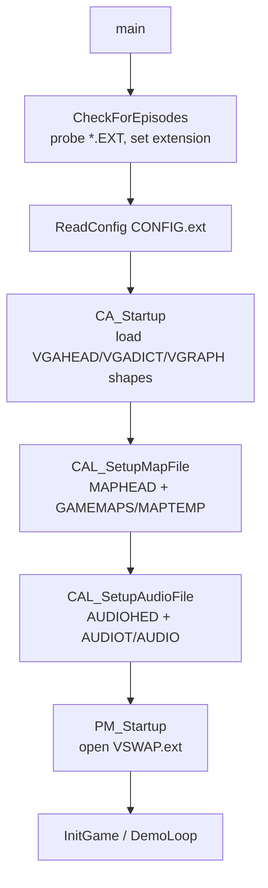

# Data requirements per asset set

What data files each build expects, and how the engine chooses between sets.

## 1. Two-stage selection

**Compile time** — `WOLFSRC/VERSION.H` (included by `ID_HEADS.H:19`) sets the
flags, and `ID_HEADS.H:27-56` includes the matching enum headers:

| Header group | Sets made available |
| --- | --- |
| `GFXV_WL6.H` / `AUDIOWL6.H` / `MAPSWL6.H` | default + registered (`!SPEAR`) |
| `GFXV_SOD.H` / `AUDIOSOD.H` / `MAPSSOD.H` | `SPEAR` (full) |
| `GFXV_SDM.H` / `AUDIOSDM.H` / `MAPSSDM.H` | `SPEAR` + `SPEARDEMO` |
| `FOREIGN/JAPAN/GFXV_WJ6.H` / `WJ1.H` | `JAPAN` (+`JAPDEMO`) |

So every executable is compiled against exactly one enum set; the sibling
`*VER.H` files (`WOLFVER.H`, `WOLF1VER.H`, `SODVER.H`, `SDMVER.H`,
`WOLFGTV.H`, `WOLFJVER.H`, `WLFJ1VER.H`, `SPANVER.H`) are the per-set flag
presets. This tree's active `VERSION.H` = `GOODTIMES` + `ARTSEXTERN` +
`DEMOSEXTERN` + `CARMACIZED` (non-Spear, 6-episode).

**Run time** — `CheckForEpisodes` (`WL_MENU.C:3882`) probes the current
directory for data files and picks a 3-letter **extension** appended to every
container name. It also enables episode-menu entries and appends the extension
to `configname`, `SaveName`, `PageFileName`, `audioname`, `demoname`
(and `helpfilename`/`endfilename` when not `GOODTIMES`).

| Build | Probe order | Chosen extension | Episodes enabled |
| --- | --- | --- | --- |
| non-Spear, `!UPLOAD` | `*.WL6` → `*.WL3` → `*.WL1` | `WL6` / `WL3` / `WL1` | 6 / 3 / 1 |
| non-Spear, `UPLOAD` | `*.WL1` | `WL1` | 1 (shareware) |
| `SPEAR` | `*.SOD` | `SOD` | Spear |
| `SPEAR`+`SPEARDEMO` | `*.SDM` | `SDM` | demo |
| `JAPAN`+`JAPDEMO` | `*.WJ1` / `*.WJ6` | `WJ1` / `WJ6` | 1 / 6 |
| `WOLF` (`ID_HEAD.H`) | `*.WLF` | `WLF` | 4 maps (legacy/console) |

## 2. Container files opened

Base names are set in `ID_CA.C:88-95`; `VSWAP.` in `ID_PM.C:29`.
`<ext>` is the runtime extension; `<GREXT>` is `"VGA"` (`ID_HEADS.H:60`).

| File | Base name | Opened at | Required? |
| --- | --- | --- | --- |
| `VSWAP.<ext>` | `VSWAP.` | `ID_PM.C:494` (`PML_OpenPageFile`) | always |
| `VGAHEAD.<ext>` | `gheadname` | `ID_CA.C:898` | always (`!GRHEADERLINKED`) |
| `VGRAPH.<ext>` | `gfilename` | `ID_CA.C:915` | always (`!GRHEADERLINKED`) |
| `VGADICT.<ext>` | `gdictname` | `ID_CA.C:883` | `!GRHEADERLINKED` |
| `MAPHEAD.<ext>` | `mheadname` | `ID_CA.C:956` | `!MAPHEADERLINKED` |
| `GAMEMAPS.<ext>` | literal | `ID_CA.C:977` | when `CARMACIZED` |
| `MAPTEMP.<ext>` | `mfilename` | `ID_CA.C:984` | when `!CARMACIZED` |
| `AUDIOHED.<ext>` | `aheadname` | `ID_CA.C:1039` | `!AUDIOHEADERLINKED` |
| `AUDIOT.<ext>` | `afilename` | `ID_CA.C:1060` | `!AUDIOHEADERLINKED` |
| `AUDIO.<EXTENSION>` | literal (`EXTENSION="WLF"`) | `ID_CA.C:1064` | when `AUDIOHEADERLINKED` |
| `CONFIG.<ext>` | `configname` ("CONFIG.") | `WL_MAIN.C:98/197` | created/saved |
| `SAVEGAM<n>.<ext>` | `SaveName` ("SAVEGAM?.") | `WL_MENU.C` save/load | created/saved |
| `DEMO<n>.<ext>` | `demoname` ("DEMO?.") | `WL_GAME.C:1061` | only `!DEMOSEXTERN` |
| `HELPART.<ext>` | `helpfilename` | `WL_TEXT.C:773` | only `!ARTSEXTERN`, `!SPEAR` |
| `ENDART<n>.<ext>` | `endfilename` | `WL_TEXT.C:835` | only `!ARTSEXTERN` |

> In this build `ARTSEXTERN`/`DEMOSEXTERN` are **defined**, so help/end/demo
> art are graphics chunks in `VGRAPH` (`T_HELPART`, `T_ENDART1..6`, `T_DEMO0..3`)
> rather than the separate `HELPART`/`ENDART`/`DEMO` files.

## 3. Sizes / index constants per set

| Constant | WL6 (`GFXV_WL6`) | WL1 (`GFXV_WL1`) | SOD (`GFXV_SOD`) | SDM (`GFXV_SDM`) |
| --- | ---: | ---: | ---: | ---: |
| `NUMCHUNKS` | 149 | 556 | 169 | 133 |
| `NUMPICS` | 132 | 136 | 147 | 125 |
| `NUMTILE8` | 72 | 72 | 72 | 72 |
| `NUMTILE16` | 0 | 144 | 0 | 0 |
| `NUMEXTERNS` | 13 | 2 | 18 | 4 |
| `NUMPICS+NUMEXTERNS` | 145 | 138 | 165 | 129 |

Audio (`AUDIO*.H`):

| Constant | WL6 | WL1 | SOD | SDM |
| --- | ---: | ---: | ---: | ---: |
| `NUMSOUNDS` | 87 | 69 | 81 | 81 |
| `NUMSNDCHUNKS` | 288 | 234 | 267 | 267 |
| `STARTPCSOUNDS` | 0 | 0 | 0 | 0 |
| `STARTADLIBSOUNDS` | 87 | 69 | 81 | 81 |
| `STARTDIGISOUNDS` | 174 | 138 | 162 | 162 |
| `STARTMUSIC` | 261 | 207 | 243 | 243 |
| music count (enum) | 27 | 27 | 24 | 24 |

Maps (`MAPS*.H`, `ID_CA.H`):

| Constant | WL6 | WL1 | SOD | SDM | WLF |
| --- | ---: | ---: | ---: | ---: | ---: |
| `LASTMAP` (named slots) | 61 | 30 | 21 | 2 | 4 |
| `NUMMAPS` (headers loaded, `ID_CA.H:4`) | 60 | 60 | 60 | 60 | 60 |
| `MAPPLANES` | 2 | 2 | 2 | 2 | 2 |

> WL6's 61st slot is `MAP4L10PATH_MAP` (index 60), beyond the engine's
> `NUMMAPS=60` load loop.

## 4. Compile-flag reference

| Flag | Defined in this tree | Effect |
| --- | :---: | --- |
| `GOODTIMES` | ✅ (`VERSION.H:3`) | skip the "NonShareware" nag (`WL_MAIN.C:1459`) and Spear `CopyProtection` (`:1467`); don't append extension to `helpfilename` (`WL_MENU.C:3980`). |
| `ARTSEXTERN` | ✅ (`:4`) | help/end art read from `VGRAPH` chunks (`WL_TEXT.C:730,767,828`). |
| `DEMOSEXTERN` | ✅ (`:5`) | demos read from `VGRAPH` chunks `T_DEMO0..3` (`WL_GAME.C:1048`). |
| `CARMACIZED` | ✅ (`:8`) | maps are Carmack-RLEW compressed, file `GAMEMAPS.<ext>` (`ID_CA.C:973`, `WL_GAME.C` save path). |
| `UPLOAD` | ✗ | shareware: probe only `*.WL1`, fewer digits/death screams (`WL_ACT2.C:1063,1101`), skip nag screen. |
| `SPEAR` | ✗ | Spear of Destiny enums/flow. |
| `SPEARDEMO` | ✗ | Spear demo: single demo chunk, SDM set. |
| `JAPAN` | ✗ | Japanese build: `WJ*` sets, article screens instead of extern art. |
| `GRHEADERLINKED` | ✗ | graphics header/dict linked into the EXE (no `VGAHEAD`/`VGADICT`). |
| `MAPHEADERLINKED` | ✗ | map header linked in (no `MAPHEAD`), uses `maphead[]`. |
| `AUDIOHEADERLINKED` | ✗ | audio header/dict linked in; file becomes `AUDIO.WLF` (`ID_CA.C:1064`). |

## 4. Shareware data files

A full copy of the Wolfenstein 3D v1.4 shareware distribution is available as
`wolf3dshareware.zip` (654.8 KB, Internet Archive, identifier `wolf3dsw`). The
zip contains nine container files, all with runtime extension **`WL1`**
(`EXTENSION="WL1"` is set by `CheckForEpisodes` when no `WL6`/`SOD`/`SDM`/``JAPAN``
data is found). The shareware build differs from the registered WL1 build only in
the available episode content and the actual data files:

| File | Shareware size | Registered counterpart | Notes |
| --- | --- | --- | --- |
| `VSWAP.WL1` | 742 912 B | `VSWAP.WL6` / `VSWAP.WL1` (registered) | page‑manager; same format, different chunk data |
| `VGAHEAD.WL1` | 471 B | same name, different offsets | 3‑byte offset table, `GREXT="VGA"` |
| `VGADICT.WL1` | 1 024 B | same | 255‑node Huffman dictionary |
| `VGAGRAPH.WL1` | 326 568 B | `VGRAPH.<ext>` | compressed graphics; shareware has 136 pics + 2 externs |
| `MAPHEAD.WL1` | 402 B | same | `mapfiletype` + `headeroffsets[100]` |
| `GAMEMAPS.WL1` | 27 425 B | `GAMEMAPS.<ext>` (CARMACIZED) / `MAPTEMP.<ext>` | 30 maps (episode 1 only) |
| `AUDIOHED.WL1` | 1 156 B | same | `AUDIOHED` header, `NUMSNDCHUNKS 234` |
| `AUDIOT.WL1` | 132 613 B | same | 69 sounds, Huffman‑compressed |
| `WOLF3D.EXE` | 109 959 B | N/A | the shareware executable (for reference) |

> **Extension selection**: `CheckForEpisodes` (`WL_MENU.C:3882`) first probes
> `*.WL6`; if not found, probes `*.WL3`; if not found, probes `*.WL1`. The shareware
> zip contains only episode‑1 data, so the game starts at episode 1 with reduced
> content (30 maps, 69 sounds, 1 episode of extern art). Registered WL1 has all
> 6 episodes and different data files (GAMEMAPS, VSWAP etc. built from the
> registered headers).

| Constant | Shareware WL1 | Registered WL1 |
| --- | ---: | ---: |
| `NUMCHUNKS` | 556 | 556 |
| `NUMPICS` | 136 | 136 |
| `NUMTILE8` | 72 | 72 |
| `NUMTILE16` | 0 | 0 |
| `NUMEXTERNS` | 2 | 2 |
| `NUMFONT` | 2 | 2 |
| `STARTFONT` | 1 | 1 |
| `STARTPICS` | 3 | 3 |
| `STARTFONTM` | 3 | 3 |
| `STARTPICM` | 135 | 135 |
| `STARTEXTERNS` | 135 | 135 |
| `NUMSOUNDS` | 69 | 69 |
| `NUMSNDCHUNKS` | 234 | 234 |
| `STARTPCSOUNDS` | 0 | 0 |
| `STARTADLIBSOUNDS` | 69 | 69 |
| `STARTDIGISOUNDS` | 138 | 138 |
| `STARTMUSIC` | 207 | 207 |
| `LASTMAP` | 30 | 30 (61 with secret) |
| `NUMMAPS` | 60 | 60 |
| `MAPPLANES` | 2 | 2 |

## 5. Runtime sequence

