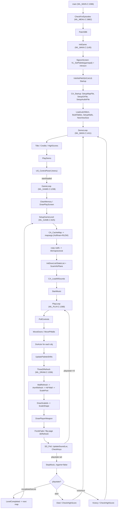

# Order of Operations & Control Flow

Control flow of the shipped DOS build (default `WL6`, `GOODTIMES` defined, no
`SPEAR`). Function names are followed by `file:line` of their definition.

---

## 1. Boot sequence — `main` (WL_MAIN.C:1586)

1. `#ifdef BETA` date gate.
2. `CheckForEpisodes()` (WL_MENU.C:3882) — probe installed data sets, choose the
   data-file `extension` (`WL6`/`WL1`/`SOD`/`SDM`/…).
3. `Patch386()` (WL_MAIN.C:241) — CPU-specific patching (`IsA386`).
4. `InitGame()` (WL_MAIN.C:1145) — bring up memory, video, input, sound, cache.
5. `DemoLoop()` (WL_MAIN.C:1411) — attract mode → menus → play, forever.
6. `Quit("Demo loop exited???")` — never reached.

### 1.1 `InitGame` (WL_MAIN.C:1145)

| # | Step |
| --- | --- |
| 1 | parse `-virtual` → `virtualreality` |
| 2 | `MM_Startup()` — memory manager (so signon can be freed) |
| 3 | `SignonScreen()` (WL_MAIN.C:727) — `VL_SetVGAPlaneMode`; `VL_SetPalette(&gamepal)`; `VL_MungePic(&introscn)`, blit; `MML_UseSpace` reclaims the linked-in screen |
| 4 | `VW_Startup` → `IN_Startup` → `PM_Startup` → `PM_UnlockMainMem` → `SD_Startup` → `CA_Startup` → `US_Startup` |
| 5 | low-memory check (`ERRORSCREEN` + `exit` if < 235000) |
| 6 | `InitDigiMap()` — apply `wolfdigimap[]` (WL_MAIN.C:849) |
| 7 | build `nearmapylookup`, `farmapylookup`, `uwidthtable`, `blockstarts` |
| 8 | `ReadConfig()` (WL_MAIN.C:90) |
| 9 | optional `DoJukebox()` (hold `M`) else `IntroScreen()` (WL_MENU.C:2882) |
| 10 | `CA_CacheGrChunk(STARTFONT)` + `MM_SetLock` |
| 11 | `LoadLatchMem()` (ID_VH.C:397) · `BuildTables()` trig (WL_MAIN.C:586) · `SetupWalls()` (WL_MAIN.C:706) · `NewViewSize(viewsize)` → `SetupScaling` (WL_SCALE.C:60) |
| 12 | `InitRedShifts()` (WL_PLAY.C:1078) · `FinishSignon()` (WL_MAIN.C:765) |
| 13 | set `displayofs=PAGE1START`, `bufferofs=PAGE2START` |

### 1.2 `CA_Startup` (ID_CA.C:1083) — cache bring-up

`CAL_SetupMapFile()` (opens `MAPHEAD.<ext>`, `GAMEMAPS.<ext>`, reads `tinf` +
`NUMMAPS` headers, allocates 2× `mapsegs`) →
`CAL_SetupGrFile()` (loads `VGADICT.<ext>` Huffman, `VGAHEAD.<ext>` offsets,
opens `VGRAPH.<ext>`, expands `STRUCTPIC` → `pictable`) →
`CAL_SetupAudioFile()` (loads `AUDIOHED.<ext>`, opens `AUDIOT.<ext>`).

---

## 2. Attract / menu loop — `DemoLoop` (WL_MAIN.C:1411)

1. `tedlevel` fast path → `NewGame` → `GameLoop` → `Quit`.
2. (full build) `NonShareware()` / `CopyProtection()` gate.
3. `StartCPMusic(INTROSONG)`; `PG13()`.
4. `while(1)`:
   - `MM_SortMem()`
   - **Title**: `CA_CacheScreen(TITLEPIC)` (SOD: `TITLEPALETTE`+`TITLE1/2PIC`) → fade in → `IN_UserInput(15s)`
   - **Credits**: `CREDITSPIC` (10s)
   - **High scores**: `DrawHighScores()` (WL_INTER.C:1030) (10s)
   - **Demo**: `PlayDemo(LastDemo++%4)` (WL_GAME.C:1044)
   - `VW_FadeOut()`
   - `RecordDemo()` (debug) **or** `US_ControlPanel(0)` (WL_MENU.C:332)
   - if `startgame || loadedgame` → `GameLoop()` → `VW_FadeOut()` → `StartCPMusic(INTROSONG)`

`US_ControlPanel` → `SetupControlPanel` (WL_MENU.C:3029, caches `CONTROLS_LUMP`
+ `STARTFONT+1`, `CA_LoadAllSounds`) → main-menu loop (`MainMenu[]`,
`HandleMenu`, `CP_*` routines) → `CleanupControlPanel`.

---

## 3. Game loop — `GameLoop` (WL_GAME.C:1238)

```
restartgame: ClearMemory; DrawPlayScreen; died=false
restart:
  do {
      DrawScore
      if (!loadedgame) SetupGameLevel()   else loadedgame=false
      ingame=true; StartMusic(); PM_CheckMainMem()
      if (!died) PreloadGraphics() else died=false
      fizzlein=true; DrawLevel()
      PlayLoop()
      StopMusic(); ingame=false
      if (demorecord) FinishDemoRecord()
      if (startgame||loadedgame) goto restartgame
      switch (playstate):
        ex_completed / ex_secretlevel -> LevelCompleted(); advance map; continue
        ex_died                      -> Died(); maybe CheckHighScore(); return
        ex_victorious                -> Victory(); CheckHighScore(); return
        default                      -> ClearMemory()
  } while(1)
```

### 3.1 `SetupGameLevel` (WL_GAME.C:625) — per-level asset load

1. reset `gamestate` counters; `US_InitRndT`
2. `CA_CacheMap(mapon + 10*episode)` (ID_CA.C:1428) — Huffman + RLEW `mapsegs`
3. `mapwidth/mapheight` from `mapheaderseg[mapon]` (must be 64×64)
4. copy wall plane → `tilemap` / `actorat` (`< AREATILE` = solid)
5. `InitActorList` · `InitDoorList` · `InitStaticList`; spawn doors (codes 90–101)
6. `ScanInfoPlane` (WL_GAME.C:221) — player, statics, enemies, boss, pushwall
7. strip ambush markers
8. `CA_LoadAllSounds()` (ID_CA.C:1208) — fault in every marked sound

---

## 4. Frame loop — `PlayLoop` (WL_PLAY.C:1368)

Per iteration, in order:

| Order | Operation |
| --- | --- |
| 1 | VR helmet angle (if `virtualreality`) |
| 2 | `PollControls()` (WL_PLAY.C:455) — `PollKeyboard/Mouse/Joystick` buttons + move |
| 3 | `MoveDoors()` (WL_ACT1.C:686) · `MovePWalls()` (WL_ACT1.C:809) |
| 4 | `for (obj=player; obj; obj=obj->next) DoActor(obj)` (WL_PLAY.C:1260) — actor think/action state machine |
| 5 | `UpdatePaletteShifts()` (WL_PLAY.C:1171) — red/white damage/bonus |
| 6 | `ThreeDRefresh()` (WL_DRAW.C:1336) — **render** |
| 7 | `gamestate.TimeCount += tics` |
| 8 | `SD_Poll()` · `UpdateSoundLoc()` (WL_GAME.C:181) |
| 9 | `if (screenfaded) VW_FadeIn()` |
| 10 | `CheckKeys()` (WL_PLAY.C:614) — pause / save / debug / menu |
| 11 | debug waits (`singlestep`/`extravbls`); demo abort (`IN_CheckAck`) |

Terminates on `playstate` set or `startgame`; then `FinishPaletteShifts()`.

### 4.1 `ThreeDRefresh` render pipeline (WL_DRAW.C:1336)

```
1  outportb(SC_INDEX, SC_MAPMASK)
2  clear spotvis (rep stosw 2048 words)          ; per-frame visibility
3  bufferofs += screenofs
4  VGAClearScreen()                              ; clear view port
5  WallRefresh()                                 ; raycast (WL_DRAW.C:1298)
     viewangle/sin/cos/viewx/viewy/focal* setup
     AsmRefresh()                              ; WL_DR_A.ASM hot loop
       -> HitVert/HorizWall, HitHoriz/VertDoor, HitHoriz/VertPWall (WL_DRAW.C)
          -> ScalePost() (WL_DRAW.C:400)       ; textured wall column
     ScalePost()                               ; flush last post
6  DrawScaleds()        (WL_DRAW.C:1072)       ; statics + actors, farthest-first
     TransformActor -> vislist -> ScaleShape() (WL_SCALE.C:421)
7  DrawPlayerWeapon()   (WL_DRAW.C:1201)
8  if (fizzlein) FizzleFade(bufferofs,displayofs,...) ; ID_VH.C:471
9  displayofs = bufferofs; set CRTC start address (port 3d4h/0Ch)
10 bufferofs += SCREENSIZE; wrap to PAGE1START
11 frameon++; PM_NextFrame()
```

Floor/ceiling texture mapping is handled by the plane code (`planepics` buffer,
`MapRow` in WHACK_A.ASM; C reference `DrawPlanes` in WOLFHACK.C).

---

## 5. State machine to asset summary

| Phase | Primary assets touched |
| --- | --- |
| Boot / signon | `GAMEPAL`, `SIGNON`, `STARTFONT` |
| Attract | `TITLEPIC`/`TITLE1/2PIC`, `CREDITSPIC`, `HIGHSCORESPIC`, music |
| Menu | `CONTROLS_LUMP` (`C_*`), fonts, `AUDIO*` |
| Level load | `GAMEMAPS`/`MAPHEAD`, `AUDIOT` (all sounds) |
| In-game render | `VSWAP` (walls/sprites), `planepics` |
| In-game audio | `AUDIOT` (PC/AdLib/Digi + music) |
| Intermission | `LEVELEND_LUMP` (`L_*`), `HIGHSCORES_LUMP`, `COPYPROT_LUMP` |
| Save/load/demo | `<SaveName>.<ext>`, `<demoname>.<ext>` |

---

## 6. Flowchart



### 6.1 Render sub-flow

```mermaid
flowchart LR
    A["ThreeDRefresh"] --> B["clear spotvis"]
    B --> C["VGAClearScreen"]
    C --> D["WallRefresh setup (angle/sin/cos)"]
    D --> E["AsmRefresh raycast loop"]
    E --> F["Hit*Wall/Door/PWall"]
    F --> G["ScalePost textured column"]
    G --> H["DrawScaleds (statics, then actors back-to-front)"]
    H --> I["DrawPlayerWeapon"]
    I --> J["FizzleFade (first frame)"]
    J --> K["set CRTC start / flip page"]
    K --> L["PM_NextFrame"]
```


