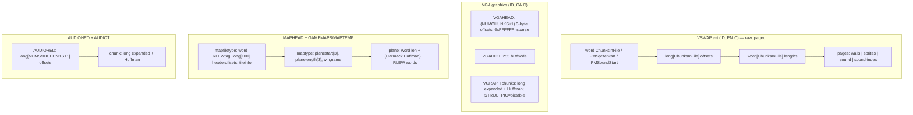

# On-disk Formats (byte-level)

Byte-precise description of every container the engine reads. Sources:
`ID_PM.C` (page manager / VSWAP), `ID_CA.C` (caching + compression), `ID_CA.H`,
`ID_PM.H`, `ID_VH.H`, `ID_SD.C`, `WL_DEF.H`. All multi-byte fields are
**little-endian** (x86). "word" = 2 bytes, "long" = 4 bytes unless stated.

File-base names (`ID_CA.C:88`): `gheadname=GREXT"HEAD."`,
`gfilename=GREXT"GRAPH."`, `gdictname=GREXT"DICT."`, `mheadname="MAPHEAD."`,
`mfilename="MAPTEMP."`, `aheadname="AUDIOHED."`, `afilename="AUDIOT."`;
`GAMEMAPS.<ext>` (`CARMACIZED`), `AUDIO.<ext>` (`AUDIOHEADERLINKED`).
Page file = `VSWAP.<ext>` (`ID_PM.C:29`). `<ext>` is the runtime `extension`
chosen by `CheckForEpisodes` (`WL_MENU.C:3882`); `GREXT` is `"VGA"`
(`ID_HEADS.H:60`).

---

## 1. VSWAP — paged graphics & digitized sound (`ID_PM.C`)

`PM_Startup` → `PML_OpenPageFile` (`ID_PM.C:485`). This file is **not**
compressed; it is randomly paged by the Id Engine page manager.

### 1.1 Header + tables

Let `N = ChunksInFile`.

| Offset | Size | Field | Notes |
| --- | ---: | --- | --- |
| 0 | word | `ChunksInFile` | total pages |
| 2 | word | `PMSpriteStart` | first sprite page |
| 4 | word | `PMSoundStart` | first digitized-sound page |
| 6 | `long[N]` | page offsets | byte offset of each page in file |
| `6+4N` | `word[N]` | page lengths | exact byte length of each page |
| `6+6N` | — | page data | referenced by the offset/length tables |

Read order in `PML_OpenPageFile`: 3 words, then `N` longs, then `N` words. A
page's data is `[offset[i], offset[i]+length[i])`.

> `offset == 0` ⇒ **sparse page** (not present). `PM_GetPage` aborts with
> "Tried to load a sparse page!" (`ID_PM.C:897`).

### 1.2 Page numbering by category

Confirmed by the in-game page viewer (`WL_DEBUG.C:240-246`):

| Page range | Category | Content |
| --- | --- | --- |
| `0 … PMSpriteStart-1` | Wall | 64×64 textures, exactly **one page (4096 bytes)** each |
| `PMSpriteStart … PMSoundStart-1` | Sprite | compiled shapes (`t_compshape`), one page each |
| `PMSoundStart … ChunksInFile-2` | Sound | 4 KB blocks of digitized audio |
| `ChunksInFile-1` | Sound Info | digitized-sound index ("DigiList") |

- `PMPageSize = 4096` (`ID_PM.H:11`). Main-memory cache blocks are one page
  each, so **every page is ≤ 4096 bytes**.
- Wall access in the renderer: `DOORWALL = (PMSpriteStart-8)`
  (`WL_DRAW.C:19`) — the eight door textures are the **last eight wall pages**.
- Sprite access: `PM_GetSpritePage(v) = PM_GetPage(PMSpriteStart+v)`
  (`ID_PM.H:63`). A sprite page is a `t_compshape` (`WL_DEF.H:1072`):
  ```c
  typedef struct {
      unsigned leftpix, rightpix;   // visible column span
      unsigned dataofs[64];         // per-column offsets
      /* segment table follows dataofs[rightpix-leftpix+1] */
  } t_compshape;
  ```

### 1.3 Digitized sounds (multi-page)

Digitized sounds are stored as `ceil(length / 4096)` **consecutive** sound pages.
The final page holds the index: an array of `{word pageOffset; word byteLength}`
pairs, up to `PMPageSize/4 = 1024` entries, where `pageOffset` is relative to
`PMSoundStart`. Parsed by `SDL_SetupDigi` (`ID_SD.C:1234`):

```
p = (word far *)PM_GetPage(ChunksInFile - 1);   // the index page
pg = PMSoundStart;
for (i = 0; i < PMPageSize / 4; i++, p += 2) {
    if (pg >= ChunksInFile - 1) break;          // NumDigi = i
    pg += (p[1] + PMPageSize-1) / PMPageSize;   // advance by page count
}
```

Playback walks pages one at a time via `SDL_LoadDigiSegment`
(`ID_SD.C:995`), locking each with `PM_SetPageLock(PMSoundStart+page, pml_Locked)`.

### 1.4 Page cache metadata (`PageListStruct`, `ID_PM.H:35`)

| Field | Purpose |
| --- | --- |
| `longword offset` | file offset of the chunk |
| `word length` | chunk length |
| `int xmsPage` | XMS slot (`xmsPage * PMPageSize` = offset into XMS handle) |
| `PMLockType locked` | `pml_Unlocked` / `pml_Locked` (only sound pages may be locked) |
| `int emsPage` | EMS logical sub-page (16 KB EMS frame = 4 × 4 KB sub-pages) |
| `int mainPage` | index into the main-memory page pool |
| `longword lastHit` | frame number, for LRU |

`PM_GetPage` (`ID_PM.C:877`) resolution order: main/EMS
address → XMS → load from file. Pages at `≥ PMSoundStart` are flagged
`mainonly` and must live in main memory. `PM_SetPageLock` refuses any page
`< PMSoundStart`.

---

## 2. VGA graphics — `VGAHEAD` / `VGRAPH` / `VGADICT` (`ID_CA.C`)

Loaded by `CAL_SetupGrFile` (`ID_CA.C:861`). Non-linked variant only (the
retail DOS build). `THREEBYTEGRSTARTS` is defined (`ID_CA.C:23`).

### 2.1 `VGAHEAD.<ext>` — chunk offset table

Array of `(NUMCHUNKS + 1)` **3-byte** little-endian offsets (`FILEPOSSIZE = 3`).
The extra slot provides the end offset.

```c
long GRFILEPOS(int c) {                 // ID_CA.C:132
    long v = *(long far *)((byte far *)grstarts + c*3);
    v &= 0x00ffffffl;
    return (v == 0xffffffl) ? -1 : v;   // 0xFFFFFF = sparse
}
```

So chunk `c` occupies `[GRFILEPOS(c), GRFILEPOS(c+1))`, and `GRFILEPOS(c) == -1`
means the chunk is not stored.

### 2.2 `VGADICT.<ext>` — Huffman dictionary

`255 × sizeof(huffnode)` = `255 × 4 = 1020` bytes.
```c
typedef struct { unsigned bit0, bit1; } huffnode;   // ID_CA.C:33
```
See §5 for the bit-stream semantics.

### 2.3 `VGRAPH.<ext>` — Huffman-compressed chunks

Chunk `0` is always `STRUCTPIC` (`#define STRUCTPIC 0`). It expands to
`pictable[NUMPICS]` of `pictabletype{ int width, height; }` (8 bytes each) —
`ID_CA.C:923`, `ID_VH.H:34`.

General chunk payload:

| Bytes | Field |
| ---: | --- |
| 4 | `long expandedLength` (4-byte little-endian) |
| … | Huffman-compressed bytes |

`CAL_GetGrChunkLength` (`ID_CA.C:195`) reads the leading long and computes
`chunkcomplen = GRFILEPOS(c+1) - GRFILEPOS(c) - 4`.

**Exception — tiles** (`STARTTILE8 ≤ chunk < STARTEXTERNS`): the expanded size is
*implicit* (`CAL_ExpandGrChunk`, `ID_CA.C:1261`):

| Chunk range | Expanded size |
| --- | --- |
| `< STARTTILE8M` | `64 * NUMTILE8` (all 8×8 tiles in one chunk) |
| `< STARTTILE16` | `128 * NUMTILE8M` |
| `< STARTTILE16M` | `64 * 4` |
| `< STARTTILE32` | `128 * 4` |
| `< STARTTILE32M` | `64 * 16` |
| else | `128 * 16` |

**Pixel layout:** VGA pictures are stored as four separate **bit-planes**
(plane 0 = every pixel's bit 0, then plane 1, 2, 3), not chunky. Evidence:
`VL_MungePic` (`ID_VH.C:170`, also `MUNGE.C`) re-orders a chunky image into
planar order, and `CAL_HuffExpand`'s `screenhack` mode writes each quarter of
the expanded data to its own plane via the `SC_MAPMASK` register
(`ID_CA.C:434-520`). Sprites additionally carry per-column "shift" tables built
by `CAL_ShiftSprite` (`ID_CA.C`, decl `ID_CA.H:60`).

---

## 3. Audio — `AUDIOHED` / `AUDIOT` (`ID_CA.C`)

Loaded by `CAL_SetupAudioFile` (`ID_CA.C:1026`).

- `AUDIOHED.<ext>`: array of `NUMSNDCHUNKS + 1` **longs** (file offsets). Read
  wholesale into `audiostarts`.
- `AUDIOT.<ext>`: chunk `c` = `[audiostarts[c], audiostarts[c+1])`:
  | Bytes | Field |
  | ---: | --- |
  | 4 | `long expandedLength` |
  | … | Huffman-compressed bytes (`audiohuffman`) |

`CA_CacheAudioChunk` (`ID_CA.C:1134`) reads + expands with `screenhack=false`.
When `AUDIOHEADERLINKED` the dictionary/offsets are linked in (`audiodict`,
`audiohead`) and the file is named `AUDIO.<ext>`.

Chunk ordering within the table (see `AUDIO*.H`): PC sounds, then AdLib sounds,
then digitized sounds, then music — delimited by `STARTPCSOUNDS`,
`STARTADLIBSOUNDS`, `STARTDIGISOUNDS`, `STARTMUSIC`. `CA_LoadAllSounds`
(`ID_CA.C:1208`) swaps the PC/AdLib block on a sound-mode change.

---

## 4. Maps — `MAPHEAD` + `GAMEMAPS`/`MAPTEMP` (`ID_CA.C`)

`CAL_SetupMapFile` (`ID_CA.C:942`) loads `MAPHEAD` entirely into `tinf` and
opens the data file (`GAMEMAPS.<ext>` if `CARMACIZED`, else `MAPTEMP.<ext>`).

### 4.1 `MAPHEAD.<ext>`

```c
typedef struct {
    unsigned RLEWtag;          // word: RLEW compression tag
    long     headeroffsets[100];  // offset of each map header in data file; <0 = sparse
    byte     tileinfo[];       // TED5 tile attributes (truncated-array)
} mapfiletype;                 // ID_CA.C:39
```

`NUMMAPS = 60` (`ID_CA.H:4`) headers are read; the on-disk table has room for
100. `RLEWtag` is fetched at expansion time as
`((mapfiletype _seg *)tinf)->RLEWtag`.

### 4.2 Map header (`maptype`, `ID_CA.H:11`) — 38 bytes

| Offset | Size | Field |
| ---: | ---: | --- |
| 0 | `long[3]` | `planestart[3]` (file offsets of each plane) |
| 12 | `unsigned[3]` | `planelength[3]` (compressed byte lengths) |
| 18 | word | `width` |
| 20 | word | `height` |
| 22 | `char[16]` | `name` |

Three plane slots are defined; the game uses `MAPPLANES = 2` (`ID_CA.H:5`).
Wolf3D requires 64×64 (`SetupGameLevel`, `WL_GAME.C:656`).

### 4.3 Plane decoding (`CA_CacheMap`, `ID_CA.C:1428`)

Each plane decompresses into `64*64*2 = 8192` bytes.

**Non-`CARMACIZED`:**
```
word  expandedLength   (unused)
...   RLEW-compressed words
```
`CA_RLEWexpand(source+1, dest, 8192, RLEWtag)`.

**`CARMACIZED`:**
```
word  carmackExpandedLength
...   Carmack-compressed words
```
`CAL_CarmackExpand(source, tmp, carmackExpandedLength)` → `tmp[0]` is the RLEW's
own (unused) expanded-length word → `CA_RLEWexpand(tmp+1, dest, 8192, RLEWtag)`.
i.e. **Carmack (Huffman) then RLEW**.

---

## 5. Compression formats

### 5.1 RLEW — run-length, 16-bit words (`ID_CA.C:677`, `:734`)

Operates on `word`s; `length` passed by the caller is the *expanded byte* count.

| Input | Output |
| --- | --- |
| `word w`, `w != tag` | literal `w` |
| `word tag`, `word count`, `word value` | `value` repeated `count` times |

Compressor only emits a tag when `count > 3` **or** `value == tag`
(otherwise literal words are cheaper). Caveat noted in source: a repeat count
that yields `0xfff0` bytes can overflow the assembly loop.

The tag is data-driven: the `RLEWtag` word at offset 0 of `MAPHEAD`
(conventionally `0xABCD`).

### 5.2 Carmack expand (`CAL_CarmackExpand`, `ID_CA.C:609`)

Word-based back-referencing. Two tag bytes in the **high half** of a word:

| `chhigh` | Low byte | Meaning |
| --- | --- | --- |
| `NEARTAG = 0xA7` | `count != 0` | next byte `offset`; copy `count` words from `outptr - offset` |
| `NEARTAG = 0xA7` | `count == 0` | literal word with low byte 0; next byte becomes the high half |
| `FARTAG = 0xA8` | `count != 0` | next **word** `offset`; copy `count` words from `dest + offset` |
| `FARTAG = 0xA8` | `count == 0` | literal word with low byte 0; next byte becomes the high half |
| else | — | literal word `ch` |

`length` is the expanded byte count (`/= 2` internally).

### 5.3 Huffman (`huffnode`, `CAL_OptimizeNodes`, `CAL_HuffExpand`)

`huffnode { word bit0, bit1; }`, table of **255 nodes**; the root is node
**254** (`headptr = hufftable + 254`, `ID_CA.C:427`).

`CAL_OptimizeNodes` (`ID_CA.C:387`) rewrites each half: values `≥ 256` become
pointers to `table + (value - 256)`. After optimization each half is:

| Value | Meaning |
| --- | --- |
| `0 … 255` | literal byte to emit |
| `256 … 510` | pointer to next node `table[value - 256]` |

Decode (`ID_CA.C:418`):
1. Start at the root node.
2. Read stream bits **LSB-first within each byte** (`cl` starts at `1` and is
   `shl`-ed each step; the code tests `ch AND cl`).
3. Bit `0` → follow `node.bit0`; bit `1` → follow `node.bit1`.
4. If the followed value is a literal, emit it and reset to the root; otherwise
   it is the next node.

The routine has two compiled paths for `< 64 KB` and `≥ 64 KB` expanded output
(normalizing `ds:si`/`es:di` in the large path), with identical bit semantics.
When `screenhack` is true, `length` is the full four-plane size; it is shifted
right by 2, and each plane is written under `SC_MAPMASK = 1, 2, 4, 8`
(`ID_CA.C:434-520`) — used by `CA_CacheScreen` (`ID_CA.C:1381`).

---

## 6. Quick reference



| Container | Index table | Payload compression | Expanded-size source |
| --- | --- | --- | --- |
| `VSWAP.ext` | inline offsets+lengths | none (raw) | length table |
| `VGRAPH.ext` | `VGAHEAD` 3-byte offsets | Huffman (`VGADICT`) | 4-byte prefix, except implicit tiles |
| `AUDIOT.ext` | `AUDIOHED` 4-byte offsets | Huffman (`AUDIODICT`/linked) | 4-byte prefix |
| `GAMEMAPS/MAPTEMP.ext` | `MAPHEAD` offsets | RLEW (non-Carmack) / Carmack+RLEW | 2-byte prefix per plane |
